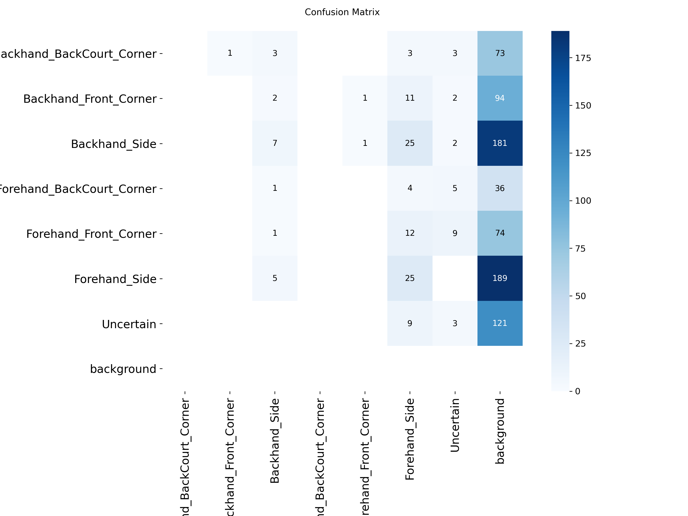

# Badminton Footwork Zone Detector

Detects a badminton player in a match video and classifies which court footwork zone the player is in. A YOLOv8s model is trained on labeled match frames, and a FastAPI backend with a web page lets you upload a video and see the results.

## What the app gives you
- Annotated video (box and zone name on the player)
- Time spent in each zone and number of zone changes
- CSV of the zone for every frame

## Model
- YOLOv8s, 100 epochs max (early stopping), image size 640
- 7 classes: 6 court zones plus Uncertain
- 1,365 labeled frames split by video (1080 train / 150 val / 135 test), so frames from one video never appear in two splits

## Results (test set, 135 images)

| Metric | Value |
|---|---|
| Precision | 0.803 |
| Recall | 0.599 |
| F1 | 0.69 |
| mAP50 | 0.659 |
| mAP50-95 | 0.402 |

First version (234 frames, YOLOv8n): mAP50 0.578. The base paper reports mAP50 0.633 for YOLOv8 on its own dataset, so the numbers are not directly comparable.

Limitations: the test set is small. Two corner zones have only 1 to 2 test examples, and two back-court zones are missing from it, so their per-zone scores are not reliable. Forehand_Side (89 images) and Uncertain (24) are the most reliable. More labeled examples of the rare corner zones are the main next step.

## How to run

    pip install fastapi uvicorn python-multipart ultralytics opencv-python imageio-ffmpeg
    python -m uvicorn backend:app

Then open http://127.0.0.1:8000, choose a match video filmed from behind the court, and click Analyze video.

Files: backend.py (API), frontend.html (web page), best.pt (trained model), analyze.py and scripts/ (analysis and data tools).