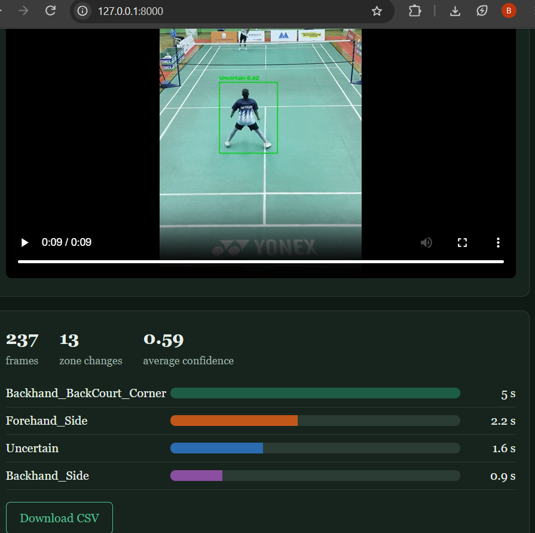
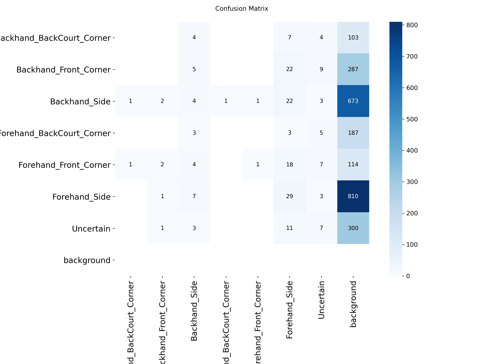
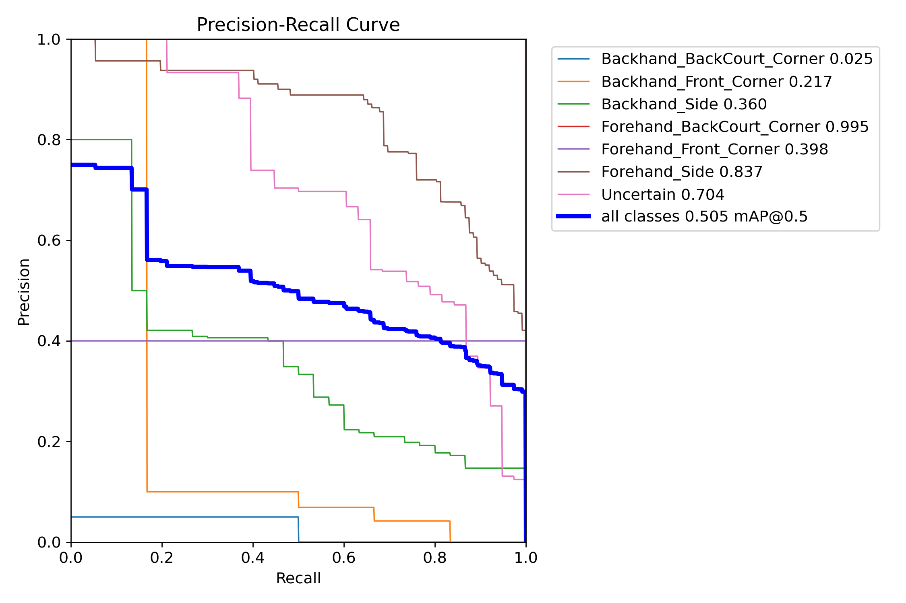
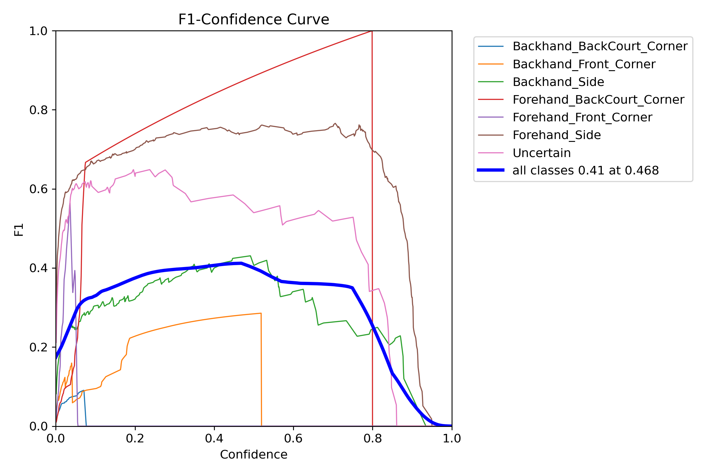
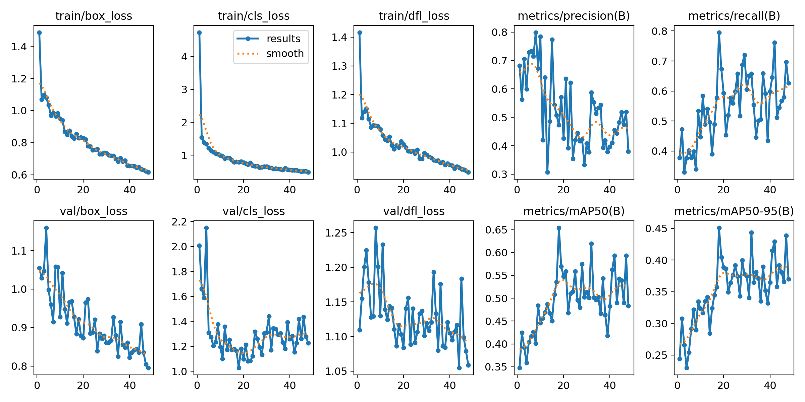

# Badminton Footwork Zone Detector (YOLOv8s)

Detects the near player's court zone in video. Returns an annotated video, time per zone and a CSV. Backend: FastAPI.

## Training
- 7 classes: 6 footwork zones + Uncertain
- yolov8s, imgsz 640, 150 epochs, fliplr=0, patience 30
- 980 train / 194 val / 191 test images, split by clip (not by match)

## Results (test split, 191 images)
mAP50 0.505 | mAP50-95 0.401 | Precision 0.634 | Recall 0.418 | F1 0.504

Reliable classes: Forehand_Side AP50 0.837 (112 boxes), Uncertain 0.704 (38), Backhand_Side 0.360 (30).
Corner classes had only 1 to 6 test boxes, so their AP50 is unreliable.

Lower than the paper (0.633) and my first model (0.578). The data and splits differ, so this is not like-for-like. The main cause is too few corner-zone examples.

## Demo
9 s clip: 237 frames, 13 zone changes, average confidence 0.59.

## Figures

## Limitations
- Labels began as predictions from an earlier model
- Corner zones had few examples
- Small, imbalanced test set

## Next step
Label more corner frames from the 3,052 extracted frames and retrain.